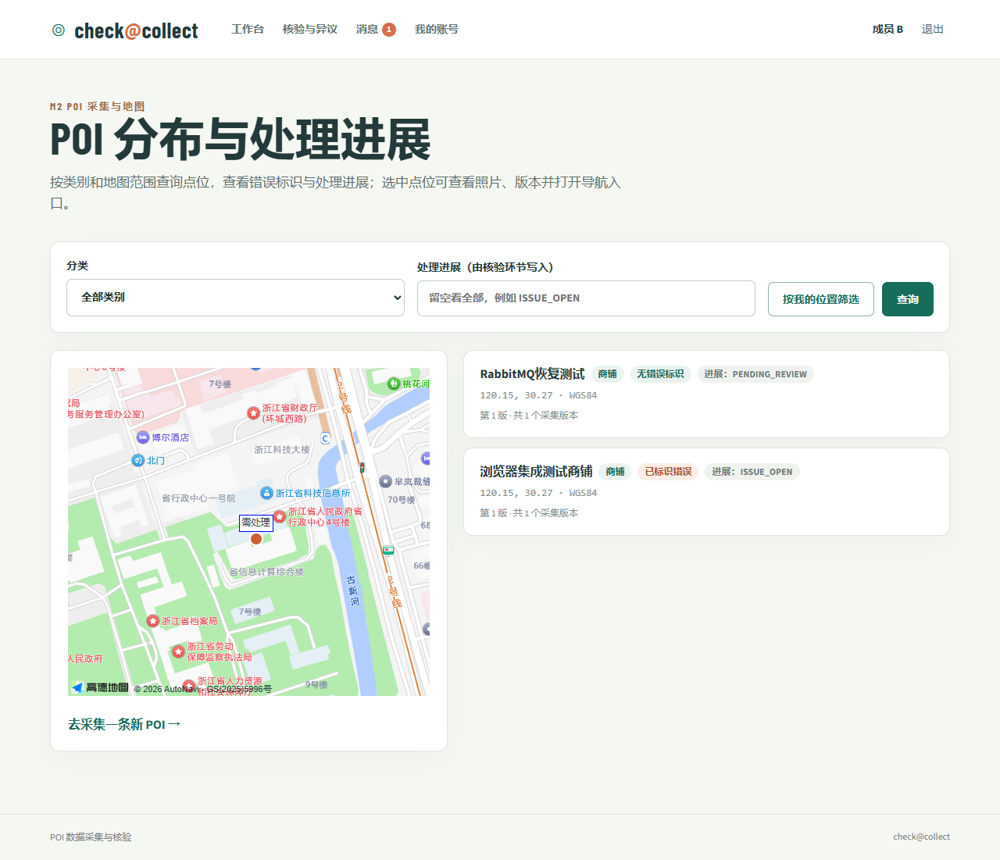
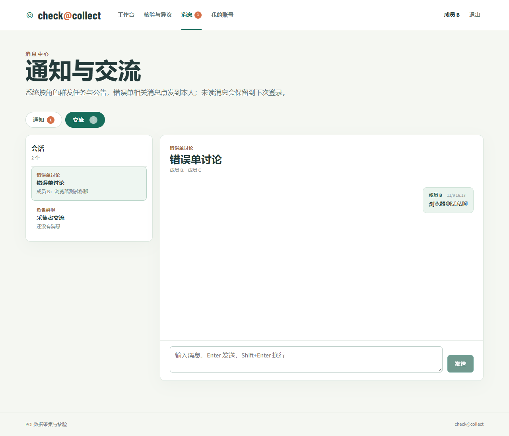
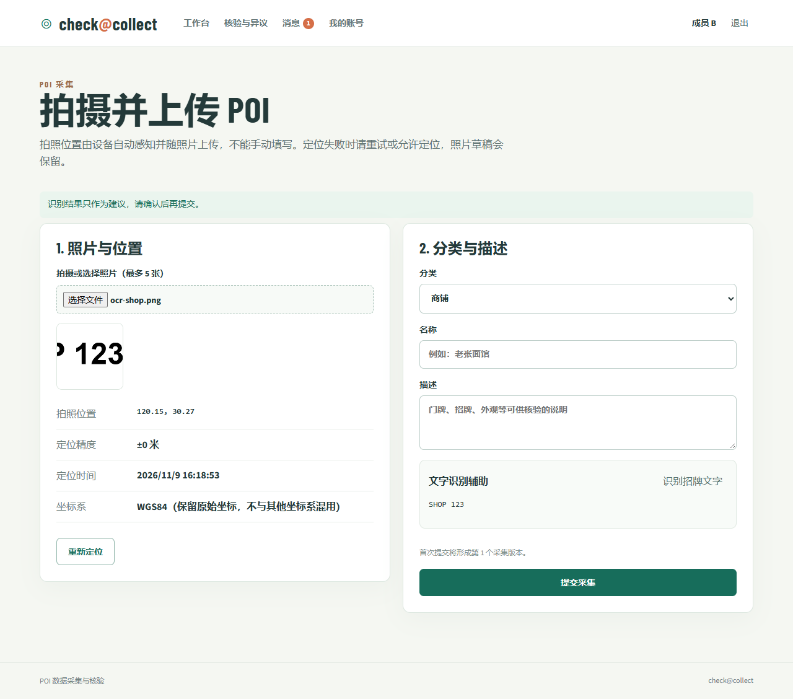

# 四模块集成记录

2026-11-09 完成 M1 与 PR #2、#3、#4 的集成修复。当前实现覆盖真实 POI、照片、核验、整改、现场证据、最终裁定、通知、私聊和角色群聊。部署选择 Linux 笔记本、Docker Compose、高德地图及 CPU PaddleOCR。

## 修复对应

| 审查项 | 实现 |
| --- | --- |
| F01 | 迁移分区为 V1、V200、V201、V300、V400 |
| F02 | Review 模块内的 PoiRevisionAdapter 调用 M2 真实服务 |
| F03 | PoiMessagingAdapter、ReviewMessagingAdapter 将业务动作映射到 M4 通知，收件人快照与业务同事务保存，提交后发送到 broker |
| F04 | 整改及现场结果支持 multipart，真实文件由 M2 保存，核验页展示版本照片，分类与 M2 统一 |
| F05 | 普通更新校验原采集者 |
| F06 | POI 行锁、活动错误单标识和预期版本共同保护更新，M3 的修改按相同锁顺序协调 |
| F07 | 真实建单时创建双方私聊，错误单跳转到指定会话，其他用户无法读取 |
| F08 | 普通更新写入待核验摘要，整改写入待复核摘要，版本指针与流程同事务更新 |
| F09 | 通知统一使用 POI、ISSUE、TASK 关联并打开实际详情 |
| F10 | 两种裁定均要求现场照片及定位，保存证据版本并明确指定最终有效版本 |
| F11 | 消息调试默认关闭，开启后写操作要求管理员，正式公告有独立入口 |

## 实际验证

- 后端执行 mvnw test，共 15 个用例通过。7 个新增集成用例使用一次性 PostgreSQL 和真实 M1/M2/M3/M4 服务，覆盖上传、通知、归属、旧版本冲突、整改、两种裁定、私聊授权、公告权限、失败补投和去重。原有 8 个 M3 用例保留为明确开启桩的模块测试。
- 390px 宽度消息页检查无横向溢出，高德页面加载检查无浏览器错误。
- 前端通过 vue-tsc 和 Vite 生产构建。应用、数据库、RabbitMQ 和 OCR 容器已在 Windows Docker Desktop 的隔离测试项目中启动。
- Edge 浏览器完成四账号登录和首次改密，核对四个不同 userId，完成实际照片上传、错误单建立和从详情进入双方私聊。
- 浏览器加载真实高德底图，完成 WGS84 点位转换并显示错误标识。高德安全密钥由后端固定目标代理附加，浏览器配置只返回 JS API Key。修复了 SDK JSONP 请求的 Content-Type。
- PaddleOCR 使用 CPU 移动端模型，实际通过应用上传测试图片，返回 HTTP 200、simulated=false，以及 SHOP 和 123。模型缓存在独立卷。固定 PaddleX 和 LangChain 兼容版本后容器正常运行。
- 真实 RabbitMQ 停机时，采集接口仍成功。通知记录为 FAILED，恢复 broker 后补投为 DELIVERED，尝试次数由 2 变为 3。

## 待部署环境验证

域名 allwayso.top 已由用户完成购买和审核。固定入口拟使用 collect.allwayso.top，DNS、HTTPS 隧道和 Linux 笔记本启动需在可访问该设备时配置。当前 Windows 本机应用入口为 http://localhost:8080。

微信网站应用的 AppID、AppSecret 和实际回调配置尚未完成本次联调。真实手机拍照/定位、微信绑定与扫码、手机导航跳转，以及 Linux 断电恢复仍需在设备与公网入口准备好后验收。自动化测试中的浏览器位置为测试坐标。

开发数据库中 member-a 至 member-d 已分别修改初始密码，当前测试登录凭据保存在本机忽略提交的 .env.demo-accounts 文件。该文件和含高德配置的 .env 均应仅在本地保存。

部署步骤见 [Linux 部署与验收](deployment-linux.md)。团队成员真实姓名、最终贡献比例及个人周总结仍由成员依据实际完成情况填写。
