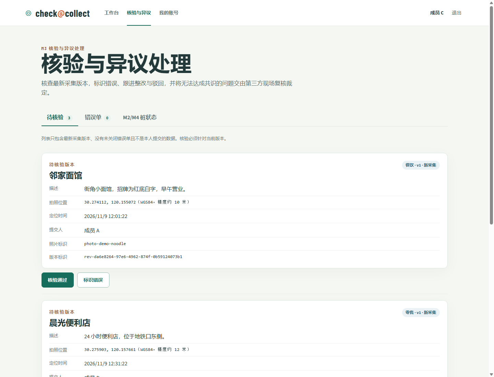
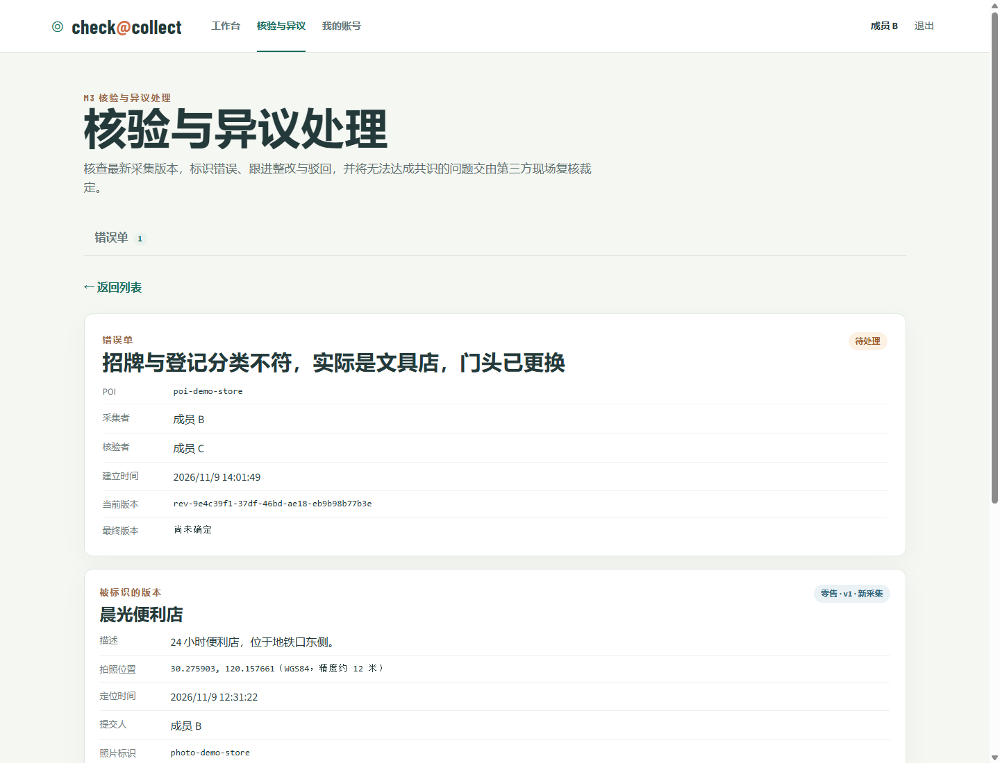
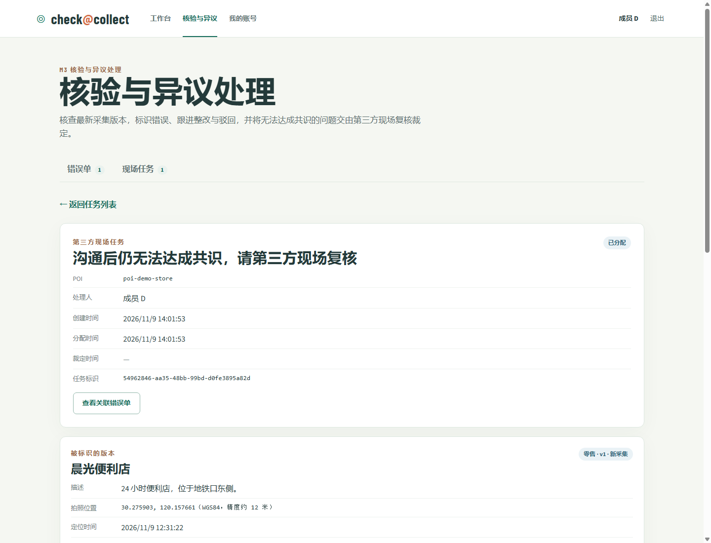
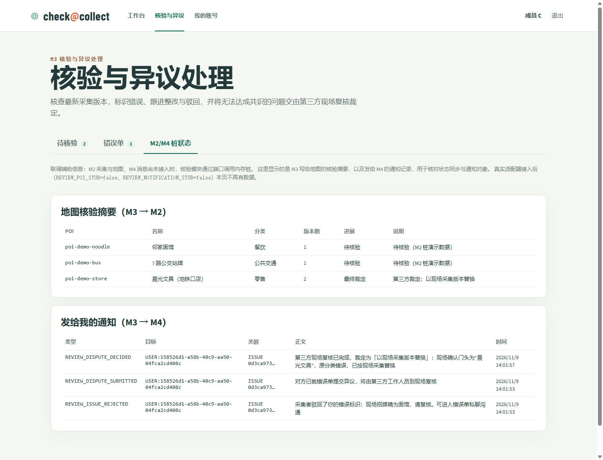

# 成员 C 实现与联调（M3 核验与异议处理）

成员 C 负责 M3：核验者对待检采集版本作结论、错误单的整改/驳回/复核状态机、异议提交、第三方现场任务派单与最终裁定，以及相应的核验页面。POI 与采集版本归 M2（成员 B），通知投递归 M4（成员 D），消息中间件由 M4 接入；M3 只通过进程内端口调用，不直接读写其他模块的数据表。

当前实现由 M1 的身份与角色服务支撑，M2、M4 已通过真实适配器接入；两个端口桩保留用于模块独立测试。桩位于 `backend/src/main/java/edu/sadp/checkcollect/review/stub/`，接入真实适配器后关闭开关即可替换，业务代码不变。

## 1. 代码位置

| 内容 | 位置 |
| --- | --- |
| 状态与领域类型 | `backend/src/main/java/edu/sadp/checkcollect/review/{IssueStatus,IssueAction,FieldTaskStatus,Verdict}.java` |
| 请求与响应 DTO | `review/ReviewViews.java`、`review/ReviewModels.java` |
| HTTP 接口 | `review/ReviewController.java` |
| 业务规则与状态机 | `review/ReviewService.java` |
| 数据访问 | `review/ReviewRepository.java` |
| 数据库迁移 | `backend/src/main/resources/db/migration/V300__review.sql` |
| M2/M4 端口 | `review/port/PoiRevisionPort.java`、`review/port/NotificationPort.java` |
| 桩与演示数据 | `review/stub/` |
| 前端页面 | `frontend/src/views/ReviewView.vue`、`frontend/src/modules/review/` |
| 集成测试 | `backend/src/test/java/edu/sadp/checkcollect/review/ReviewFlowIntegrationTest.java` |

## 2. 错误单状态机

状态：`OPEN` 待处理 → `PENDING_RECHECK` 待复核 → `RESOLVED` 已解决；驳回后 `DISPUTED` 有异议；提交异议后 `IN_ARBITRATION` 第三方处理中；撤回错误标识或第三方裁定后 `CLOSED` 已关闭。`RESOLVED` 与 `CLOSED` 不再参与流转。

| 动作 | 执行人 | 前置状态 | 结果 | 通知 |
| --- | --- | --- | --- | --- |
| 核验通过 `PASSED` | 核验者 | 版本为最新且未核验 | 不建单，记录通过 | 无（不额外点发） |
| 核验标识错误 | 核验者 | 版本为最新且未核验 | 建单 `OPEN` | 点发原采集者 |
| 整改 `CORRECTED` | 原采集者 | `OPEN`、`DISPUTED` | 经 M2 生成新版本，`PENDING_RECHECK` | 点发核验者 |
| 驳回 `REJECTED` | 原采集者 | `OPEN` | `DISPUTED`，必须说明理由 | 点发核验者 |
| 撤回驳回 `RESUMED` | 原采集者 | `DISPUTED` | `OPEN` | 点发核验者 |
| 确认整改 `CONFIRMED` | 核验者 | `PENDING_RECHECK` | `RESOLVED` | 点发采集者 |
| 退回整改 | 核验者 | `PENDING_RECHECK` | `OPEN`，必须说明原因 | 点发采集者 |
| 撤回错误标识 | 核验者 | `OPEN`、`PENDING_RECHECK`、`DISPUTED` | `CLOSED`，当前版本为最终版本 | 点发采集者 |
| 提交异议 | 当事任一方 | `DISPUTED` | `IN_ARBITRATION`，建立异议单与现场任务 | 点发对方；点发被指派第三方，或群发管理员 |
| 提交最终裁定 | 被指派第三方 | `IN_ARBITRATION` 且任务 `ASSIGNED` | 错误单 `CLOSED`、异议单 `DECIDED`、任务 `COMPLETED` | 分别点发争议双方 |
| 补充说明 `NOTE` | 当事双方、被指派第三方 | 未结束 | 状态不变 | 无 |

不变量（数据库与代码共同保证）：

- 同一 POI 同时最多一张未关闭错误单（部分唯一索引 `review_issues_one_active_per_poi`）。
- 每个采集版本只有一条首次核验记录（`review_records_revision_id_idx`）；整改版本的复核结论记在错误单历史中。
- 已解决或已关闭错误单确认的版本不再进入待检列表，避免重复核验。
- 所有状态变更必须携带操作人看到的当前版本标识，版本已更新时返回 `409`。
- 第三方处理人不能是异议当事人，也不能修改已完成的裁定。
- 核验结论、M3 记录与 M2 核验摘要在同一事务内提交；通知在事务提交后发出，投递失败只记日志，不撤销业务结果。

## 3. HTTP 接口

所有接口要求已登录会话；写请求需要 CSRF 凭证（`GET /api/auth/csrf` 取得，放入 `X-XSRF-TOKEN`）。错误统一为 `{"message": "..."}`。

| 方法与路径 | 允许角色 | 说明 |
| --- | --- | --- |
| `GET /api/reviews/pending?page=&size=` | 核验者 | 待检列表：每个 POI 的最新版本中未核验、无未关闭错误单、非本人提交的记录，含提交人显示名 |
| `POST /api/reviews` | 核验者 | `{"revisionId":"...","outcome":"PASSED\|ISSUE","description":"..."}`；`ISSUE` 必须填写说明 |
| `GET /api/reviews/pois/{poiId}` | 已登录 | 某 POI 的核验记录与错误单，供地图详情与采集者自查 |
| `GET /api/issues?status=&mine=&page=&size=` | 已登录 | 默认只看自己参与的错误单；管理员 `mine=false` 查看全部 |
| `GET /api/issues/{id}` | 当事双方、被指派第三方、管理员 | 详情：被标识/当前/最终版本、处理历史、异议、现场任务、当前可执行动作 |
| `POST /api/issues/{id}/notes` | 同上 | `{"revisionId":"...","note":"..."}` |
| `POST /api/issues/{id}/revisions` | 原采集者 | `{"revisionId":"...","collection":{...},"note":"..."}` 整改 |
| `POST /api/issues/{id}/rejections` | 原采集者 | `{"revisionId":"...","note":"必须填写"}` |
| `POST /api/issues/{id}/resumptions` | 原采集者 | `{"revisionId":"...","note":"..."}` |
| `POST /api/issues/{id}/confirmations` | 核验者 | `{"revisionId":"...","note":"..."}` |
| `POST /api/issues/{id}/change-requests` | 核验者 | `{"revisionId":"...","note":"必须填写"}` |
| `POST /api/issues/{id}/withdrawals` | 核验者 | `{"revisionId":"...","note":"..."}` |
| `POST /api/disputes` | 当事双方 | `{"issueId":"...","revisionId":"...","reason":"必须填写"}` |
| `GET /api/disputes?mine=&page=&size=` | 已登录 | 异议列表 |
| `GET /api/field-tasks?status=&mine=&page=&size=` | 第三方工作人员、管理员 | 第三方默认只看本人任务；管理员 `mine=false` 查看全部（含待分配） |
| `GET /api/field-tasks/{id}` | 当事双方、处理人、管理员 | 任务详情 |
| `PATCH /api/field-tasks/{id}` | 管理员 | `{"assigneeId":"..."}`；为空时按当前负载自动选择 |
| `POST /api/field-tasks/{id}/result` | 被指派第三方 | `{"verdict":"ORIGINAL_CORRECT\|REPLACED","reason":"必须填写","collection":{...}}`；`REPLACED` 必须附现场采集内容 |
| `GET /api/review-stub/pois` | 管理员、核验者；仅桩模式 | 桩中每个 POI 的最新版本与已同步的核验摘要 |
| `GET /api/review-stub/notifications` | 已登录；仅桩模式 | 当前用户可见的通知桩记录 |

采集内容 `collection` 字段：`category`（必填）、`name`、`description`、`latitude`、`longitude`、`accuracyMeters`、`coordinateSystem`（`WGS84`/`GCJ02`/`BD09`）、`locatedAt`、`photoId`。缺少照片、分类、坐标、定位时间或坐标系不合法时返回 `400`，不会创建版本。

## 4. 与 B、D 的进程内接口

### M3 → M2（`PoiRevisionPort`）

| 方法 | 约定 |
| --- | --- |
| `getRevision(id)` | 读取不可变版本，不存在返回空 |
| `latestRevision(poiId)` | 该 POI 最新版本，用于禁止核验旧版本 |
| `latestRevisions()` | 全部 POI 的最新版本，用于计算待检列表 |
| `createRevision(RevisionDraft)` | 由 M3 完成身份、状态与任务校验后调用；用途为 `CORRECTION`（整改）或 `FIELD_CHECK`（第三方现场采集，附 `fieldTaskId`） |
| `setReviewSummary(poiId, revisionId, ReviewSummary)` | 写回地图展示用的核验进展；地图以摘要为准，核验历史以 M3 记录为准 |

真实实现接入后设置 `REVIEW_POI_STUB=false`。若 M2 的实现需要不同的方法签名，应在 `review/port` 内调整并同步本文件与 `docs/work-allocation.md`，不让 M3 直接访问 M2 的数据表。

### M3 → M4（`NotificationPort`）

`notify(type, target, reference, text)`，`target` 为用户或角色之一，`reference` 为 `ISSUE` / `FIELD_TASK` / `REVISION` 关联。M3 已使用的通知类型：

| 类型 | 目标 | 触发 |
| --- | --- | --- |
| `REVIEW_ISSUE_REPORTED` | 采集者 | 核验标识错误 |
| `REVIEW_ISSUE_CORRECTED` | 核验者 | 采集者提交整改 |
| `REVIEW_ISSUE_REJECTED` | 核验者 | 采集者驳回 |
| `REVIEW_ISSUE_RESUMED` | 核验者 | 采集者撤回驳回 |
| `REVIEW_ISSUE_CHANGES_REQUESTED` | 采集者 | 复核退回 |
| `REVIEW_ISSUE_RESOLVED` | 采集者 | 整改通过 |
| `REVIEW_ISSUE_WITHDRAWN` | 采集者 | 核验者撤回错误标识 |
| `REVIEW_DISPUTE_SUBMITTED` | 对方当事人 | 提交异议 |
| `REVIEW_FIELD_TASK_ASSIGNED` | 第三方工作人员（关联任务） | 派单或改派 |
| `REVIEW_FIELD_TASK_UNASSIGNED` | 管理员角色 | 无可用的第三方工作人员 |
| `REVIEW_DISPUTE_DECIDED` | 争议双方各一条 | 第三方最终裁定 |

真实实现接入后设置 `REVIEW_NOTIFICATION_STUB=false`。M3 不直接发布 RabbitMQ 消息，也不依据投递结果改变业务状态。

### 前后端与联调开关

| 环境变量 | 默认 | 说明 |
| --- | --- | --- |
| `REVIEW_POI_STUB` | `false` | 使用内存 POI 版本桩 |
| `REVIEW_NOTIFICATION_STUB` | `false` | 使用记录型通知桩 |
| `REVIEW_DEMO_DATA` | 跟随 `APP_SEED_DEMO` | 桩模式下写入三条演示 POI 版本 |

## 5. 数据表

`V300__review.sql` 只创建 M3 的四张表与错误单历史表，标识与版本号以不透明字符串保存，引用 `app_users` 外键校验用户存在：

- `review_records`：首次核验记录（`PASSED`/`ISSUE`），每个版本唯一。
- `review_issues`：错误单主体，含被标识版本、当前版本、最终版本、双方、状态与时间。
- `review_issue_events`：处理历史，`seq` 保证同一事务内的先后顺序，记录不修改。
- `review_disputes`：异议单，每张错误单最多一次。
- `review_field_tasks`：现场任务，`UNASSIGNED`/`ASSIGNED`/`COMPLETED`，完成的记录必须同时有裁定、最终版本与依据。

## 6. 页面

`/review` 按角色显示页签与操作，页签与选中的错误单/任务通过查询参数（`tab`、`issue`、`task`）保存，刷新与分享链接不丢状态。

- **待核验**（核验者）：最新待检版本，可直接通过或填写错误说明后标识错误。
- **错误单**（所有登录用户，按参与人过滤；管理员可看全部）：状态筛选、进入详情。
- **错误单详情**：被标识版本、整改版本、最终版本、处理历史与当前可执行动作。动作按钮由后端 `allowedActions` 决定，前端不自行推断权限，后端仍逐个校验。
- **现场任务**（第三方、管理员）：分配情况与裁定结果；被指派第三方提交两种裁定之一，两种裁定都必须附现场采集证据；管理员可分配与改派。
- **M2/M4 桩状态**（核验者、管理员）：核对地图核验摘要与通知记录，接入真实模块后不再显示数据。

采集表单的位置只能来自设备定位（`navigator.geolocation`），取不到定位时提示授权或重试且不允许提交，不能手工填写坐标；照片上传由 M2 负责，整改与现场采集通过 multipart 提交真实照片。

## 7. 独立模块阶段的启动与演示（历史记录）

以下保留早期桩模式验收过程；正式集成演示使用 [完整演示脚本](demo-script.md)，不要开启桩或按历史图片判断线上状态。

沿用 [成员 A 说明](member-a.md) 的启动步骤。首次启动时设置：

```text
APP_SEED_DEMO=true
DEMO_PASSWORD=<至少 10 位>
REVIEW_DEMO_DATA=true      # 可选，默认跟随 APP_SEED_DEMO
```

演示账号：`member-c` 为核验者，`member-b` 为采集者，`member-d` 为第三方工作人员，`member-a` 为管理员兼采集者。首次登录需改密。

### 演示三幕

1. **核验与整改闭环**：`member-c` 在“待核验”通过一条记录，另一条点“标识错误”并填写说明；`member-b` 在“错误单”看到待处理单据，填写说明驳回或提交整改（需定位）；`member-c` 复核确认，状态变为已解决，桩状态页可见摘要从“已标识错误”变回“核验通过”。
2. **异议与第三方裁定**：`member-b` 驳回后与 `member-c` 沟通无果，在详情提交异议；系统按负载指派 `member-d` 并点发任务；`member-d` 在“现场任务”提交“原数据无误”或以现场版本替换；错误单关闭、地图摘要变为“最终裁定”，`member-b` 与 `member-c` 各收到一条裁定通知。
3. **无可用第三方**：停用所有第三方账号后提交异议，任务保持“待分配”并群发管理员；恢复账号后管理员在详情选择处理人改派。

每一步都能在“M2/M4 桩状态”页看到 M3 写入地图的摘要与发出的通知类型、目标，用于核对端口调用是否符合约定。

## 8. 验证记录

- 后端集成测试：`cd backend && .\mvnw.cmd test`，8 个用例全部通过。使用嵌入式 PostgreSQL 真实执行 Flyway 迁移、真实 Spring Security（含 CSRF 与角色校验），只有 M2/M4 是桩。覆盖：待检与通过、标识错误、驳回/撤回驳回/整改/确认、复核退回、撤回错误标识、异议派单与现场裁定、无可用第三方时管理员分配、越权与过期版本、分页校验、桩检查接口可见性。
- 前端：`cd frontend && npm run build` 通过（`vue-tsc` 类型检查 + Vite 构建）。
- 真实运行：打包后以 `INITIAL_ADMIN_USERNAME`、`APP_SEED_DEMO=true` 连接本地 PostgreSQL 启动，用浏览器按 `member-c → member-b → member-d → member-c` 走完“标识错误 → 驳回 → 异议 → 现场替换 → 最终裁定”，接口返回与通知桩记录符合预期：






## 9. 集成现状与限制

- 真实照片上传、POI 分类目录与地图展示已接入 M2，版本卡片可展示照片。
- 通知、已读与错误单私聊已接入 M4，错误单详情可进入双方讨论。
- 演示数据只写入内存桩，重启后由 `REVIEW_DEMO_DATA` 重新生成，不进入数据库。
- 第三方派单为简单的按负载选择加管理员改派，不含地域、技能或时间窗策略；这是初版约定。
